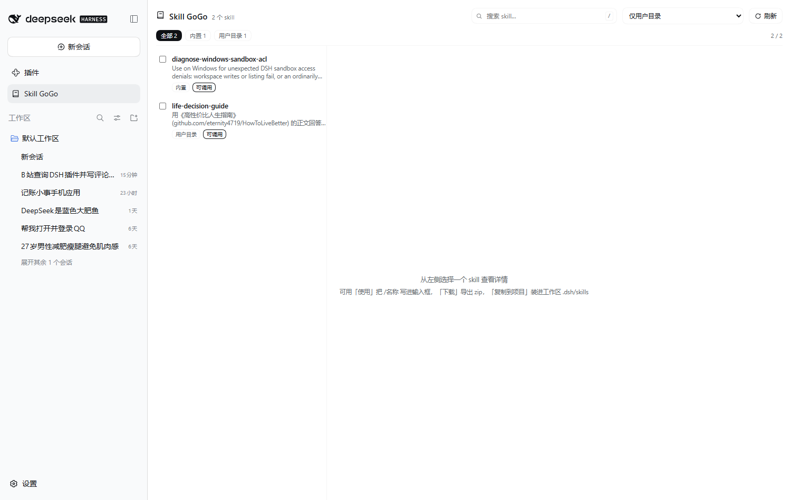
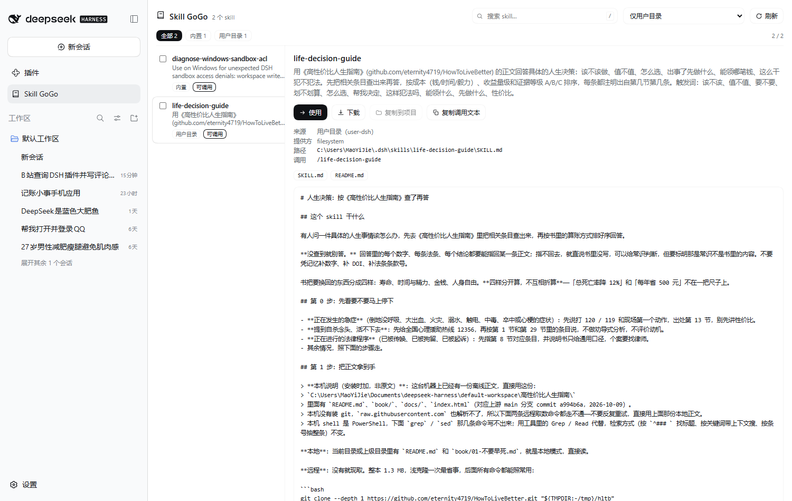
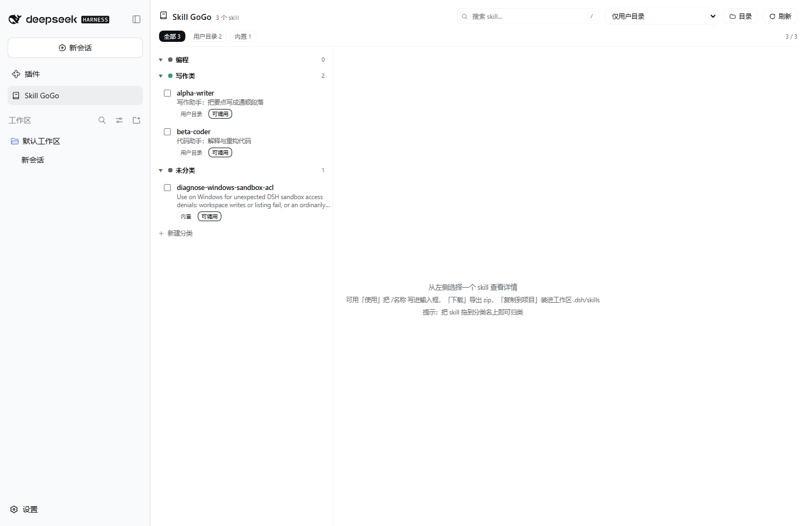
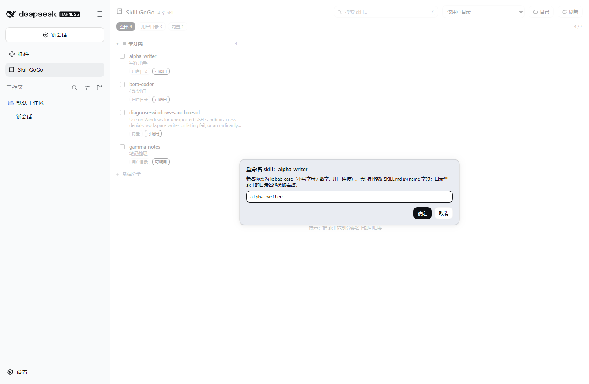
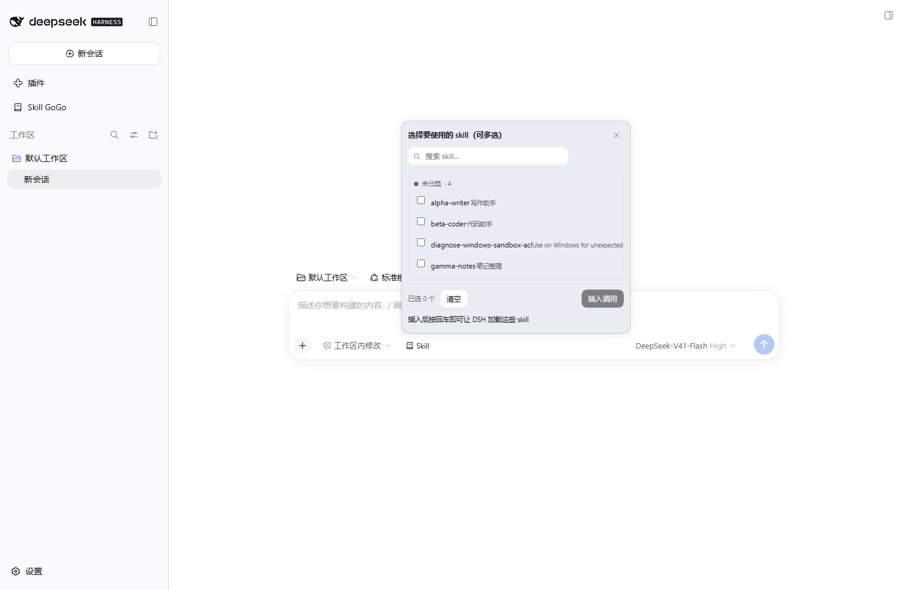
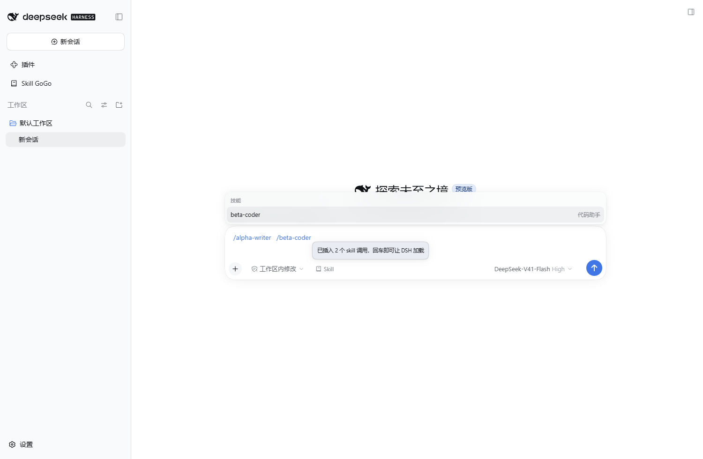
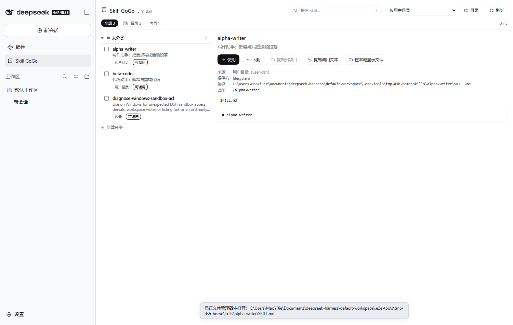

# Skill GoGo

在 DSH 工作区里**浏览、分类、查看、选择、使用和下载 skill** 的面板插件。

装好之后，左侧边栏会出现一个「Skill GoGo」入口（书本图标），点开就是一个技能面板：

- **看**：列出当前 profile 能看到的全部 skill —— 用户目录（`$DSH_HOME/skills`）、项目级（`<工作区>/.dsh/skills`、`.agents/skills`）、内置（bundled）、自定义目录，带头部来源标签与数量统计。
- **分类**：自建文件夹把 skill 分组 —— 顶部「＋ 新建分类」新建；把 skill **拖到分类名上**即可归类；分类上**右键**可以重命名、改颜色、上移 / 下移排序、删除（删除后 skill 回到「未分类」）；skill 行右键也有「移动到分类」。折叠状态与分类库都会持久保存。
- **选**：搜索框（`/` 聚焦，匹配名称 / 描述 / 何时使用）、来源筛选 chip、行首复选框多选 + 批量「移动到分类」。
- **用**：
  - 面板里：详情页「使用」把 `/skill-name` 写进当前会话输入框（写不进去就退回复制到剪贴板）；「复制调用文本」只复制。
  - **对话输入区**：输入框左侧多了一个「**Skill**」菜单，点开是带搜索、按分类分组的 skill 列表，**可以多选**，点「插入调用」一次性把 `/a /b` 写进输入框（写不进去就整串复制到剪贴板）。
- **下载**：「下载」把 skill 目录打包成 `<name>-skill.zip`（含 `skill-gogo.manifest.json` 清单）；多选后可「批量下载」。
- **装进项目**：「复制到项目」把 skill 文件复制到 `<工作区>/.dsh/skills/<name>/`，之后该工作区的会话就能把它当项目级 skill 用（不覆盖已存在的同名目录）。
- **本地显示**：skill 行右键（或详情页按钮）「在本地显示文件」—— 用系统文件管理器打开该 skill 所在目录并**选中**入口文件（Windows 资源管理器 `/select`、macOS Finder `-R`、Linux `xdg-open`）；URL / opaque 型 skill 没有本地文件，该菜单项会置灰。
- **重命名**：skill 行右键「**重命名 skill**」—— 弹框改名后真正落盘：改写 `SKILL.md` 的 `name:` 字段；目录型 skill（目录名 = 旧名字）会顺手把**目录名**也改掉，平铺 `<name>.md` 会改文件名；分类归属自动跟着迁移；内置（`app.asar` 内只读）或没有本地文件的 skill 会拒绝并说明原因。
- **自定义目录**：顶部「目录」按钮可维护**多个**补充 skill 目录 —— 可浏览选择（带"含 SKILL.md"标记）、也可用系统目录选择器；这些目录里的 skill 会和用户目录一起出现在面板里，**并且注册进 `ctx.skills`（rank 250）**，所以模型和 `/名字` 调用同样能用。

面板文案跟随宿主语言（内置 zh / en 字典），配色只使用 DSH 主题 token，自动跟随明暗主题。

## 界面















---

## 目录结构

```text
skill-gogo/
├── package.json          # dsh.bundle.patch（宿主挂载）+ dsh.client（浏览器半区声明）
├── cordis.patch.yml      # 挂载声明：- insert: [{ id: skill-gogo, name: dsh-skill-gogo }]
├── lib/
│   ├── index.js          # 宿主半区：/skill-gogo/api/* 接口 + 信任栅栏 + 提供方注册
│   ├── skills.mjs        # 数据层：skill 目录解析、文件枚举、zip 打包（无依赖）
│   ├── library.mjs       # 分类库：文件夹 / 归属 / 补充目录的读写与校验（原子写）
│   ├── customdirs.mjs    # 自定义目录：frontmatter 解析 + ctx.skills 提供方
│   └── zip.mjs           # 纯 JS 的 store 模式 zip 写入器（无第三方依赖）
├── lib/client.js         # 浏览器半区：官方 client 插件 bundle（无需构建）
├── test/
│   ├── smoke.mjs         # 数据层冒烟测试
│   └── host.test.mjs     # 宿主半区集成测试（真实 http 服务 + 38 项断言）
└── README.md
```

插件自己的数据只有一个文件：`$DSH_HOME/skill-gogo.json`（默认 `~/.dsh/skill-gogo.json`），
保存分类、归属与补充目录；写入前做完整校验（长度 / 数量 / 颜色白名单 / 绝对路径），
并采用"临时文件 + rename"原子落盘，坏数据一律回退为空库。

**没有构建步骤**：`lib/client.js` 按 `dsh-client-modules` 的懒加载工厂格式手工编写
（`window.__ModuleLoader__.load({ id, factory })`），只 `require('react')`，改完刷新页面即生效。

## 安装

桌面端（当前 profile）让 DSH 自己装 —— 会话里说一句，或用 `plugin_manager` 工具：

```
plugin_manager { action: "install_bundle", target: "link:C:\\Users\\MaoYiJie\\Documents\\deepseek-harness\\default-workspace\\skill-gogo" }
```

`link:` 是软链安装：改本目录的代码即改插件（改了宿主半区要重启 DSH，只改前端刷新页面即可）。
若想拷一份进去、之后本目录可删，用 `target: "<绝对路径>"`（pnpm 会复制）。

命令行（`dsh` 在 PATH 上、且桌面端**完全退出**时可用）：

```powershell
dsh plugin --profile desktop add link:C:\Users\MaoYiJie\Documents\deepseek-harness\default-workspace\skill-gogo
```

卸载：`plugin_manager { action: "remove_bundle", target: "dsh-skill-gogo" }`。

> ⚠️ **桌面端首次安装后要重启一次桌面端**：Electron 外壳在启动时一次性收集 index 注入表
> （客户端插件的 boot 行就在这张表里），运行期新装的客户端 bundle 进不了已经启动的页面。
> 重启后侧边栏才会出现 Skill GoGo。

## HTTP 接口（宿主半区）

所有接口都在 `/skill-gogo/api/*`，只认回环地址 + 同源请求，写操作额外要求回环来源；
宿主存在 `connection.requestRejection` 时再委托它判一次，校验器自身出错一律按 403 处理。

| 方法 | 路径 | 说明 |
|---|---|---|
| GET | `/skill-gogo/api/ping` | 存活与版本、已挂载路由表 |
| GET | `/skill-gogo/api/state?cwd=` | skill 目录 + 来源统计 + 工作区列表 + 分类库 + 目录状态 + 计数 |
| GET | `/skill-gogo/api/skill?name=&cwd=` | 单个 skill 的摘要 + 正文 + 文件清单 + 目录 |
| GET | `/skill-gogo/api/file?name=&cwd=&path=` | 预览 skill 目录内的单个文件（带越界保护） |
| GET | `/skill-gogo/api/export?name=&cwd=` | 打包下载 zip（`Content-Disposition: attachment`） |
| POST | `/skill-gogo/api/install` | `{name, cwd}` → 复制到 `<cwd>/.dsh/skills/<name>/` |
| GET | `/skill-gogo/api/library` | 读分类库（文件夹 / 归属 / 补充目录）+ 调色板 + 文件路径 |
| POST | `/skill-gogo/api/library` | 局部保存 `{folders?, assignments?, dirs?}`（改 `dirs` 会让提供方失效并重扫） |
| GET | `/skill-gogo/api/dirs` | 补充目录状态：是否存在、各含多少 skill |
| GET | `/skill-gogo/api/dirs/list?path=` | 目录浏览（给"添加目录"对话框用）：子目录 + 是否含 `SKILL.md` |
| POST | `/skill-gogo/api/rescan` | 手动让 skills 目录缓存失效并重扫 |
| POST | `/skill-gogo/api/reveal` | `{name, cwd}` → 在系统文件管理器里打开 skill 目录并选中入口文件；返回 `{revealed, mode, platform, dryRun}` |
| POST | `/skill-gogo/api/rename` | `{name, newName, cwd, renamePath?}` → 改 SKILL.md 的 `name`、可选改目录/文件名、迁移分类归属；非法名 400、重名 409、内置 skill 拒绝 |

> 设 `SKILLGOGO_REVEAL_DRY_RUN=1` 时 `/api/reveal` 只计算目标、不真正拉起文件管理器（自动化测试用）。

`cwd` 决定项目级 skill 是否可见；`ctx.skills` 按 scope 分层，插件会先用活跃 agent 作为
scope 查一次（拿到 preset 层的提供方），再补全局层，同名以更近的层为准。

## 验证状态

- `node test/host.test.mjs` —— **54 项断言全过**：目录 / 详情 / 文件预览 / 目录越界拒绝 /
  zip 导出（再用 Windows 自带 `Expand-Archive` 独立解压校验、内容逐字节一致）/
  复制到项目 / 重复复制拒绝 / 跨站与伪造 Host 与跨源 Origin 全部 403 /
  分类库保存与落盘回读 / 非法 dirs 拒绝 / 补充目录注册成提供方并进入目录 /
  目录浏览与 hasSkill 标记 / rescan 语义 / reveal 的 select 模式与 400/404/405 分支 /
  **rename：frontmatter 改写、目录型改目录名、平铺型改文件名、分类归属迁移、非法名 400、重名 409、未知 skill 500** /
  卸载后路由归零。（测试把 `DSH_HOME` 指到临时目录、`reveal` 走 dry-run，不会碰真实环境。）
- `node test/frontmatter.mjs` —— frontmatter `name` 改写的边界用例（LF / CRLF / 缺 name / 带引号 / 无 frontmatter）。
- 真实浏览器端到端（独立临时 profile + 临时 DSH_HOME + 系统 Edge）：
  - v0.2 分类/目录：**16 项全过** —— 面板打开、界面新建两个分类、右键菜单、右键重命名、
    右键改颜色（落盘颜色一致）、右键下移改变顺序、右键「移动到分类」、**真鼠标拖拽归类**、
    刷新后分类与归类仍在、打开目录对话框、浏览列出子目录并标记含 SKILL.md、补充目录保存、
    补充目录 skill 进入目录（source=custom）、来源 chip 出现「自定义目录」、无 JS 报错。
  - v0.3 本地显示：**6 项全过** —— 右键菜单含「在本地显示文件」、点击后返回
    `mode=select` 的 SKILL.md 真实路径、详情动作行同样有该按钮、无 JS 报错。
  - v0.4 重命名 + 输入区菜单：**16 项全过** —— 输入区「Skill」按钮出现、弹出多选面板、
    按分类列出 skill、多选计数、插入（写输入框或复制兜底）、弹层关闭、右键菜单含
    「重命名 skill」、对话框预填原名、非法名前端拦截、重命名成功并刷新列表、
    磁盘上 frontmatter 与目录名都已更新、无 JS 报错。
- 安装包校验（从 tgz 装进全新 profile）：**5 项全过** —— 客户端 boot 图含 bundle、
  宿主版本与路由表、右键菜单项存在、点击返回真实本地路径、无 JS 报错。
- **桌面端（desktop profile）**：宿主半区是 `link:` 装的工作区目录；v0.4 的宿主部分
  （`/api/rename`、`/api/reveal`、分类接口）需要**重启一次 DSH** 才会加载，前端 bundle 刷新页面即更新。

## 已知限制

- 依赖 `@deepseek-ai/dsh-skill`：该服务缺失时面板显示「skill 服务不可用」而不是空白。
- 「使用」与输入区「插入调用」优先调用 DSH 输入区插槽的正式 API
  （`inputActions.captureInsertion()` → `insertText(text, token)`，与宿主自己的插入通道一致）；
  拿不到该句柄时才退回操作 `[data-composer-input]`，再不行则**自动把调用串复制到剪贴板**并提示。
- 只处理本地目录型 skill（`resourceBase.kind === 'directory'`）；URL / opaque 型 skill 只展示元信息，不提供下载、本地显示与重命名。
- 「在本地显示文件」是宿主进程直接拉起系统文件管理器（`explorer.exe /select` / `open -R` / `xdg-open`），
  只在插件自己的 HTTP 接口里触发，接口仍受回环 + 同源信任栅栏保护。
- 「重命名 skill」会**真的改磁盘文件**：改写 `SKILL.md` 的 `name:`；当目录名等于旧名字时连目录一起改名，
  平铺 `<name>.md` 改文件名。内置 skill 在 `app.asar` 内只读，会被拒绝。
- 导出走 store 模式 zip（不压缩），大目录受 `lib/skills.mjs` 的 `DEFAULT_LIMITS` 限制（400 个文件 / 单文件 2 MB / 合计 32 MB）。
